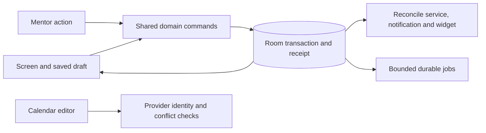

# Holistic repair implementation

This change implements the five stages of [the application audit](review/AUDIT.md): immediate destructive failures, shared task/session commands, reliable records and analytics, everyday UX/recovery, and dependable Mentor contracts.

## Product contracts

| Area | Resulting behavior |
|---|---|
| Tasks | Current records drive rows; edits patch changed fields; filtered reorder retains global positions. Parent completion cascades explicitly and has event-scoped Undo. Goal moves include steps. |
| Deletion | Soft deletion uses batch identities. Trash and Undo cannot reverse a newer deletion. Restore reads current records, follows the current parent goal, exposes missing parents, and promotes unfinished steps beneath completed parents. |
| Work | Room enforces one active session. Session-scoped commands finalize work and history together. Stops are idempotent, stale controls cannot stop a new session, and reflection targets the ended session. |
| Calendar | Plans, measured work, breaks, milestones, usage, and provider events retain source identity. Full intervals and all-day exclusive dates survive edits. Recurrence changes delegate to the calendar app. Provider failures retain drafts. |
| Rewards | Immutable lifetime credits/debits; atomic purchase checks; explicit USD/local-Monday cap/no-carryover policy; zero first reward also locks the task's lifetime earning identity. |
| Health | Captured dates, atomic habit patches, tri-state observations, editable nutrition previews/manual entry, deduplicated submissions, and dated/revision-bound recaps. |
| Usage | Coalesced transactional ingestion, raw interval preservation, clipped union metrics, explicit coverage/freshness, and DST-aware charts from one committed snapshot. |
| Voice | Token-scoped tap/hold state machine, explicit cancel, no error-partial submission, true available local recognition or explicit provider consent, bounded deterministic draft parsing. |
| Mentor | Shared domain commands, durable turns/receipts, request identity, actual HTTP cancellation, bounded tools/jobs/compaction, stable discovery, explicit ambiguity and set/clear operations, memory revision checks. |
| Privacy/capabilities | Actual granted/healthy state; website collection separate from blocking; encrypted keys; optional sharing and automatic requests; protected system recovery broadcasts and non-exported internal alarms. |
| Recovery | Verified schema/checksums/preferences before replacement, closed/checkpointed database snapshots, preserved previous data, durable interrupted-restore recovery, explicit restart state, and credential exclusions. A broken startup database is retained with its sidecars and selected preferences before installing an accepted verified archive; those original files are not a guaranteed valid rollback archive. |

## Architecture

UI drafts and pending state live in feature ViewModels/SavedStateHandle. Room is authoritative for sessions, history, completion identities, money, coverage, and durable AI work. AppScope owns finite in-process work; WorkManager owns scheduled network/compaction jobs. Database-backed screens wait for startup recovery on IO. Platform service/notification/widget effects reconcile after local commands commit.

Shared contracts are in `data/TaskCommands.kt`, `SessionFinalizer.kt`, `SessionTiming.kt`, `HealthCommands.kt`, `UsageIngestion.kt`, `AppTime.kt`, and the calendar repository. Calendar read/write results distinguish denial, absence, conflict, unsupported recurrence, and failure. External creates carry command identity and use query/retry recovery; local receipts commit with their effects.

One source of measured work excludes completion markers, plans, and ambiguous legacy TODO/legacy recovered timers. Intervals are half-open and clipped at local day boundaries. Overlaps use a union for headline work/usage; break segments remain distinct.

Backup operations own process-level busy/result/error state. Rotation or leaving a screen cannot re-enable Close or start a competing restore while an accepted operation writes. Navigation and database-backed content remain gated during verification and maintenance. Task rows observe the active session and own their elapsed tick, keeping their controls and labels current even when the surrounding list is skipped by Compose.

## Migration safeguards

Database v12→v13 is additive. Original activity/nutrition history remains available with provenance. Legacy false habits are unknown, true values remain known. Completed tasks and redeemed wishes produce a labelled opening reward snapshot; old mutable data cannot reconstruct immutable historical earnings. Legacy timer preferences recover once with an interruption/uncertainty label.

Missing/cyclic task parents and unsupported nested steps are made reachable without deleting records. Steps inherit their top-level task's valid goal. The upgrade report retains original and repaired relationship values. Fresh schema export and actual Android Room validation are part of the regression suite. V12 fixtures come from the original generated schema; v2–v11 fixtures are representative constructions from the retained migrations.

## Validation

Validation ran on 2026-10-10 with JDK 17, Android SDK 36, and the repository's pinned Gradle wrapper.

| Check | Result |
|---|---|
| JVM regression tests | 87 passed; zero failures, errors, or skips |
| Android repository/workflow tests | 50 passed on an API 36 x86_64 emulator |
| Debug and Android-test APKs | Both built successfully |
| Android lint | Passed with zero errors; 73 warnings and six hints remain |
| Whitespace validation | `git diff --check` passed |

Lint's remaining findings are dependency/catalog/style advisories, optional launcher/widget resources, intentional durable preference commits, untranslated programmatic overlay strings, primitive state boxing, and an exact-alarm advisory. Exact alarms have a capability check and a caught permission-revocation fallback to inexact delivery. No lint baseline was introduced.

The suites cover interval/DST partitions, parser phrases and corrections, reward policy, durable calendar drafts, cancelled HTTP calls, health transactions, simultaneous spending, session finalization/rollback, stale control identities, task workflow combinations, migration preservation, usage replacement/rollback, Mentor compaction/memory, and backup schema/checksum/recovery behavior. CI repeats unit/lint/build and Android repository/migration tests.

Tests use disposable local calendar/database records and fake local HTTP responses. No real Mentor API request was made. Passing a representative migration fixture does not establish that every historical user database has been tested.

Live emulator acceptance confirmed that all six tabs render, saved history remains accessible with usage collection paused, and enabling the accessibility service connects without the audit's constructor crash. Creating a task, starting it, and completing it removed the active session and cleared its running marker. An offline database snapshot contained 46,546 ms of measured task work and a separate zero-duration completion milestone. Reopening, starting again, and stopping worked; successive UI snapshots showed the task's elapsed label advancing from 13 to 26 seconds, within one second of the global session bar.

Export through Android's document picker completed, retained its success/restart state after rotation, and kept normal screens gated until restart. The finished archive passed ZIP CRC, both manifest checksums, schema-version and SQLite integrity checks; it preserved the task and both finished sessions with no active session. Closing/reopening returned to the saved task successfully. Final app error logs contained no application crashes. Accessibility and orientation settings were restored to their original emulator values.

## Device checks

An emulator establishes database, navigation, and service-start regressions. Physical-device checks are still required for supported browser URL reporting, OEM blocking/overlay policies, screen-off delivery, DND behavior across Android versions, actual recognizer/Nano availability, account-backed calendar synchronization, TalkBack, large text, and fold transitions. These are validation limits, not claims that device behavior has been established by unit tests.
