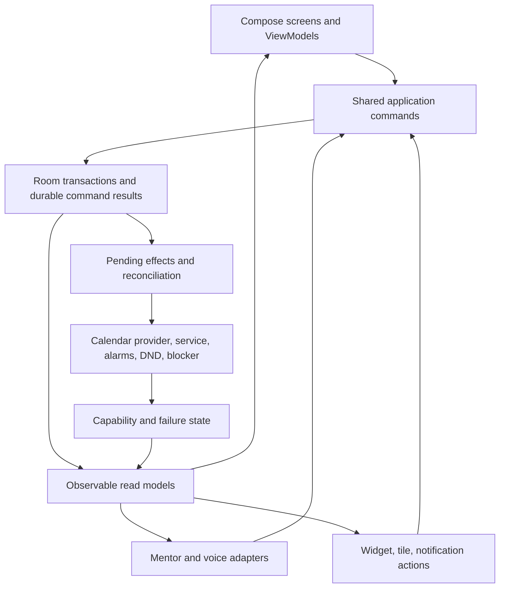

> Historical audit of commit `8e63d9d`, before the repairs. See [the implementation report](../IMPLEMENTATION.md) for current behavior and validation.

# Bibo: holistic product, logic, architecture, and UX review

Reviewed 10 October 2026, repository `Ilsan2002/bibo`, main at `8e63d9d41358735cfc8d5db5bb6d3cf46b6b5282`.

**The app's most serious problem is inconsistent ownership of shared state.** A task, its timer, its calendar history, its reward, and its reminders form one user workflow, but several screens and background components update them independently. This explains why individually plausible buttons fail when combined. There are also direct defects in calendar identity, temporal conversion, parsing, permission setup, and recovery.

Keep Kotlin, Compose, Room, and the local-first approach. The useful next step is to establish shared, transactional actions and trustworthy records, then simplify the flows around them. A framework replacement would leave most of these logic defects intact.

This is a review, with external verification artifacts. Application source was not changed. The accompanying [implementation plan](IMPLEMENTATION_PLAN.md) turns the findings into reviewable repair stages.

## How to read the review

Start with the priority table and architecture below. Each detailed report contains action sequences, actual versus expected behavior, source references, confidence, proposed fixes, and regression scenarios.

| Area | Detailed review |
|---|---|
| Tasks, subtasks, goals, Treats, reminders | [tasks-goals.md](tasks-goals.md) |
| Timer, focus, Pomodoro, blocking, widget, tile | [timer-focus.md](timer-focus.md) |
| Calendar, editing, recurrence, navigation, timeline | [calendar-time.md](calendar-time.md) |
| Daily, nutrition, habits, usage, websites, voice, accessibility | [health-usage-voice.md](health-usage-voice.md) |
| Mentor, tools, memory, check-ins, privacy, day review | [mentor-ai.md](mentor-ai.md) |
| Database, consistency, migrations, recovery | [data-architecture.md](data-architecture.md) |

The reports overlap where a defect crosses features. Treat their overlapping IDs as evidence for one issue, rather than adding the counts together. P1 means serious data loss, core workflow failure, or wrong-entity mutation; P2 means a substantial accuracy, recovery, or usability failure; P3 means a smaller improvement. Ordering below considers impact and normal-use likelihood as well as severity.

## What Bibo is trying to do

The product connects four jobs:

1. **Plan:** choose goals, break them into small steps, schedule commitments and reminders.
2. **Do:** start a task or focus session and limit distractions.
3. **Record:** retain measured work, completed outcomes, habits, intake, and observed screen use.
4. **Review:** understand the day, choose the next action, and optionally get coaching or earn a treat.

The best version of Bibo would make that loop dependable. A user should be able to start a goal's step, switch screens, finish it, inspect the session, and trust that every screen agrees. Mentor should accelerate that same workflow. It should not introduce a different definition of a task, a calendar event, or a completed session.

Useful foundations already exist: reactive Room queries, on-device records, a shared timer controller, adaptive navigation, linked goals, a timeline combining several sources, manual fallbacks, and additive migrations without destructive fallback. These are worth keeping.

## How the current implementation behaves

- `MainActivity` switches between six composable screens, unmounting the inactive screen. At wide widths, Calendar and Tasks compose together. Screen state mostly lives in `remember`/`rememberSaveable`; there are no screen ViewModels or typed navigation destinations.
- Room v12 owns tasks, goals, blocks, habits, food, usage, websites, wishlist items, chat and digests. Running timer state and other preferences live in SharedPreferences. `TodoTask.startedAt` separately mirrors part of the timer state.
- Composables, Mentor tools, the timer controller, widget, and receivers perform their own writes. Several multi-record operations consist of separate DAO calls. Individual Room calls have transactions, but the surrounding user command does not.
- `AppScope` lets some jobs survive tab navigation. It is still an in-process coroutine scope; it does not survive process death, serialize conflicting commands, or guarantee a durable result.
- `ActivityBlock` mixes measured work, local plans, voice logs, and guessed task-completion intervals. It lacks task/session/completion identity. Stats, Mentor, Daily, and Timer apply different source and duration rules.
- Calendar rendering flattens provider events, local blocks and observations into rectangles. Some display identities use list indices; recurrence-instance identity, date-only spans, and end dates are lost along the path to editing.
- Website recording and focus blocking share an accessibility service. UI capability checks mostly inspect granted settings rather than a functioning service.
- Mentor uses OpenRouter and OkHttp, executes domain mutations directly, and stores action receipts after effects. README still describes Anthropic/Claude SDK integration and database v11.

## What should be fixed first

Evidence labels: **Reproduced** means the installed app or an executable source probe produced the result. **Code-confirmed** means the path directly follows from source, without claiming full UI/provider reproduction. **Interleaving** means a demonstrable concurrency/failure window whose frequency needs runtime measurement.

| Priority | Concrete problem and user impact | Evidence and location | Recommended action |
|---|---|---|---|
| P1 | Enabling accessibility crashes Bibo repeatedly; websites and blocking fail together | **Reproduced**, `WebTracking.kt:114`; TF-01/HV01; [crash log](/workspace/bibo-audit/accessibility-crash.log) | Initialize Context-dependent state after attachment; expose live service readiness |
| P1 | Task start leaves Play unchanged; second tap restarts it; completion leaves timer active. Stale rows can also overwrite newer fields | **Timer/completion reproduced; edit rollback source/SQL-confirmed**, `TodoScreen.kt:165`; TG01/D1; [runtime evidence](/workspace/bibo-audit/TASK_TIMER_REPRO.md) | Keep drag IDs only; derive current rows; write only the intended field |
| P1 | Completing a task has different effects in Tasks, Goal profile, and Mentor; timers can remain active or steps become hidden | **Code-confirmed**, TG02/TG03/D2/D5 | One completion/deletion command, including subtree session settlement |
| P1 | Deleting a normal, series-backed occurrence targets the entire synchronized series, through UI and Mentor | **Code-confirmed provider target**, `DeviceCalendarRepo.kt:111`, `MentorTools.kt:547`; CAL-01/AI-01 | Protect series scope immediately; implement occurrence identity and explicit operations |
| P1 | Title-only edits shorten multi-day events; 49 hours becomes one hour | **Reproduced conversion**, CAL-02 | Preserve complete start/end dates, original zone/offset and unedited fields |
| P1 | Stop erases the recoverable session before asynchronously saving it; fast start/stop can corrupt task state | **Interleaving/failure window**, TF-03/TF-04/D3/D4 | Durable session ID, serialized lifecycle commands, transactional finalization |
| P1 | A stale widget Stop can start a new timer; Start can time a different task or stop an active focus | **Code-confirmed**, TF-05 | Explicit task-ID Start and session-ID Stop; refresh on committed changes |
| P1 | Stop & reflect keeps timing/blocking active, and an old sheet can stop a newer session | **Code-confirmed**, TF-06 | Stop immediately; reflection edits the ended session by ID |
| P1/P2 | Two habit changes overwrite each other; a pending food log moves to the newly selected day | **Source/SQL interleaving**, HV03/HV04/D6/D7 | Atomic habit patches; capture target day before asynchronous work |
| P1/P2 | Two treat purchases can spend the same balance; reopening/deleting/editing tasks changes already-earned money | **Interleaving and SQL reproduction**, TG04/TG05/D9/D10 | Atomic redemption; immutable reward ledger and explicit reversal policy |
| P1/P2 | Undo can restore invisible children without parents; moving a parent leaves steps in the old goal | **SQL reproduction**, TG06/TG09/D8/AI-12 | Transactional subtree actions; enforce relationship and restore rules |
| P1/P2 | Taps can retain old calendar item snapshots; index-based identity can target the wrong object | **Code-confirmed stale capture**, CAL-03 | Stable source/occurrence IDs; current semantic click handlers; resolve current data |
| P2 | Blocking says enabled without accessibility; DND permission is missing; reminder permission is requested through Focus only | **Code-confirmed**, TF-02/TF-08/TG12 | Shared capability state with in-context setup and truthful applied results |
| P2 | All-day continuations vanish; Today fails after swiping; editor parsing overwrites manual corrections | **Code-confirmed**, CAL-04/CAL-05/CAL-08 | Date-range all-day model, one selected date, explicit parse suggestion |
| P2 | Voice gives wrong overnight, duration, meridiem and date results; health fallback logs negated/future statements | **Executed parser probes**, HV06/HV07 | Structured editable drafts; typed temporal output; bounded validated parsing |
| P2 | Usage ingestion exposes partial/stale cache; merged gaps count as use; DST heatmap totals are wrong | **Interleaving, SQL and arithmetic reproduction**, HV11/HV12/HV13 | One ingestion owner, atomic snapshots, accurate raw intervals and coverage |
| P2 | Mentor can mutate the first fuzzy match; effects survive without receipts; local creations cannot be edited/cancelled through its provider-only tools | **Code-confirmed**, AI-03/AI-05/AI-06 | ID-based discovery and commands, durable receipts, unified scheduling repository |
| P2 | Check-in coroutine timeout cannot interrupt blocking HTTP; memory compaction skips conversations; pending chat disappears on tab return | **Code-confirmed**, AI-02/AI-09/AI-16 | Cancellable HTTP, persisted turn/compaction status, bounded scheduled jobs |
| P2 | Cloud connection lacks Disconnect and check-in controls; disclosures omit automatic calls and speech fallback behavior | **Code-confirmed disclosure/control mismatch**, AI-08/HV10 | Explicit settings, data-sharing scope, opt-out, accurate provider descriptions |

Recurring provider deletion was traced, not executed against an actual synchronized account. Concurrency and process-death rows describe proven unsafe orderings, not measured production incident rates. Detailed reports identify platform checks separately.

## Feature-by-feature product and UX assessment

| Feature | User's reasonable expectation | Proposed behavior |
|---|---|---|
| Task inbox | Edits appear immediately; filters and order are understandable | Visible All/Goal scope, current rows, full task editor, safe drag order, pending/error feedback |
| Subtasks | Steps remain recoverable; parent completion has a clear meaning | Completed-step visibility; explicit remaining-step action; reversible cascade provenance |
| Goals | Create a goal before any tasks; card and profile agree | Always-visible creation; shared outcome/step progress; first actionable leaf; archive/restore |
| Calendar planning | See obligations and know where a save went | Writable destination choice, recurring scope, all-day/overnight editors, successful-save receipt |
| Activity diary | Time represents actual or clearly estimated work | Measured sessions, explicit estimates, and completion markers visibly distinct; notes/goal links retrievable |
| Focus/timer | One session everywhere; Stop means stopped | Persistent active-session UI, consistent Pause/Stop/Finish/Switch, reflection after finalization |
| Pomodoro | Phase/count/alerts survive realistic interruptions | Explicit overdue-phase policy, work/break segments, clock-based reconciliation and configurable alerts |
| Blocking/DND | The phone is protected when the app claims so | Separate requested/granted/applied/healthy states; independent website-tracking consent; recovery action |
| Treats | Earnings and spending have a clear durable explanation | Ledger history, atomic spend, defined reset/carryover/currency; edit/remove wishlist independently of affordability |
| Daily/habits | Unknown is different from skipped; mistakes can be corrected | Configurable habits, unknown/done/skipped, immutable target day, editable food estimates and Undo |
| Voice | Cancel cancels; recognized intent is visible before saving | Listening/processing/error states, session tokens, editable date/items preview, manual entry and bounded fallback |
| Stats/websites | Numbers agree, unknown history is labelled, collection can be paused | One snapshot and metric contract, exact drill-down, coverage/freshness state, accurate raw observations |
| Reminders | Alerts arrive and open the promised task | In-context permission readiness, unique notification identity, task/goal deep link, edit/cancel/snooze |
| Mentor | Reliable actions, understandable progress, correctable memory | Shared commands, entity discovery, action cards with status/Undo, persistent turns, versioned memory |
| Widget/tile | The displayed control performs the displayed action | Entity-scoped commands, consistent switch policy, committed-state updates and reconciliation |
| Fold/large text/accessibility | Same work survives layout/navigation changes | Saved drafts/typed navigation, sensible pane widths, semantic controls, readable contrast and agenda alternative |

### Make everyday actions discoverable

The current empty Tasks screen offers Add task but hides the only manual New Goal route. Goal filtering requires an undisclosed long press. Ordinary due-date/reminder management requires AI, and even Mentor cannot modify an existing reminder. Affordable wishlist items lose their Remove control. These are workflow gaps, not cosmetic polish.

Use a task detail view for title, goal, due date, reminder, reward and steps; keep creation available in empty states. Show filter scope and a clear reset. Every editable record should have a local correction route, regardless of AI access or budget state.

### Preserve context across screens

Show a compact active-session bar across tabs, including its task/goal and Stop. A screen change should preserve drafts and pending operations. Notification/widget taps should open the exact entity or session. Resolve stale/deleted identities to a clear explanation rather than another task.

A Today overview could connect next commitments, the next actionable step, the current session and a small Daily check-in. Keep the existing tabs during stabilization; validate a navigation reduction with the user's workflow rather than undertaking a navigation rewrite alongside logic repairs.

### Make the feedback trustworthy

Completing an untimed task currently creates fifteen minutes of apparent activity; reopening and recompleting creates more blocks. Real task-timer work is then omitted from some focus totals. Habits default false and reviews call them missed even when they were never logged. Screen-use history beyond collection coverage looks like zero. These records feed coaching, making technical inaccuracies sound like judgments about the user.

A completion is a milestone. A session is measured time. Food values may be estimates. Missing data is unknown. Use those distinctions in storage, analytics and wording before polishing the coaching tone.

### Accessibility belongs in the interaction model

Calendar events and hold-to-talk rely on raw pointer gestures without normal semantic actions. Habits and heatmaps convey state primarily through color. Theme probes found several small-text color combinations below 4.5:1 contrast. Provide semantic click/toggle states, tap-based speech controls, exact text summaries and an agenda/list alternative. Verify keyboard, TalkBack, large text and narrow/folded layouts; screenshot inspection alone does not establish accessibility.

## Architecture that supports these expectations

Use one authoritative state owner for each domain and one implementation of each action. ViewModels own presentation and drafts. Domain commands own validation and local consistency. Platform adapters own external effects and capability status.

Start in the existing module with `domain`, `data`, `platform`, and feature presentation packages. Introduce interfaces where deterministic tests or external-effect recovery need them. Separate Gradle modules later only if dependency boundaries justify them.

### Authoritative records

| Record | Owns | Important rules |
|---|---|---|
| Task/goal | Current plan, hierarchy, order, archive state | Valid parent relationships; defined inherited goal membership; field-specific patches |
| WorkSession/segment | Task/goal association, actual start/end, work/break, interruption | Stable ID; one active session; finalization once; elapsed and wall time handled separately |
| TaskCompletion | Outcome timestamp and any cascade | Stable ID and provenance; meaningful Undo; no invented actual duration |
| PlannedEvent | Local appointment or external reference | Timed instant/zone versus all-day date range; original event and occurrence identity; destination/capabilities |
| RewardEntry | Credit, debit, explicit reversal | Immutable amount and period; atomic balance constraint; unique completion/redemption command |
| Habit/food log | Explicit report or estimate, target day, provenance | Unknown/done/skipped; finite validated values; correction and atomic multi-item save |
| UsageObservation | Accurate raw interval and collection coverage | Display merging cannot alter totals; committed ingestion watermark; clear unsupported/missing data |
| Conversation turn/command receipt | Pending/completed/failed work and applied effects | Durable identity; retry/cancel semantics; receipts survive process interruption |
| Memory revision/digest | User corrections and generated summaries | Version checks; facts-only is not conversation-compacted; recoverable history |

Preferences may remain in prefs/DataStore. Live sessions belong with their durable history. Keep credentials out of default backup transfer and define the user-data backup policy explicitly.

### Representative command contracts

- `CompleteTask(taskId, commandId)` reads current state and applies one documented hierarchy policy; settles an affected session, records a completion, grants/reverses rewards by policy, and requests reminder reconciliation. Every entry point calls it.
- `StopSession(sessionId, commandId)` finalizes that session once. A repeated or stale Stop returns an already-ended/stale result and cannot start or end another session.
- `AttachReflection(sessionId, note)` edits the ended record. It has no effect on the current session.
- `MoveTask(taskId, goalId, commandId)` updates a coherent subtree or an explicitly supported ownership model. Moving a task cannot hide its children.
- `SetHabit(day, habit, state)` changes only the named fact; `SaveHealthLog(targetDay, draft, commandId)` atomically saves the accepted draft to its original day.
- `RedeemTreat(itemId, commandId)` reads current item and budget/ledger state in one transaction and returns success, insufficient funds or already redeemed.
- `MutateCalendarItem(stableItemId, expectedVersion, operation)` validates writable capability, occurrence/series scope, interval and destination. It never silently substitutes an unrelated record or storage destination.

Commands return typed outcomes. The UI keeps a draft on failure and reports success after a commit. An arbitrary exception string, swallowed failure, premature haptic or dismissed sheet cannot be the persistence contract.

Room and the calendar provider cannot share a transaction. For external side effects, persist a pending operation and reconcile it with traceable provider identity. Do not promise exactly-once external writes unless the adapter can detect/recover an ambiguous result. Keep database transactions short, outside inference and network calls.

### Shared time and analytics

Centralize clock, display zone, current day/week, interval intersection and temporal validation. Use half-open windows (`start <= time < end`). For totals, sum interval intersections in milliseconds before rounding. Store enough boot/monotonic and wall-clock context to reconcile interrupted sessions. Preserve date-only all-day ranges and original offsets for unchanged events.

Define whether task sessions count as focused time, whether breaks count, whether concurrent foreground apps are summed or unioned, and what happens at a weekly reward reset. One shared read model should supply charts, goal progress, DayReview, widget and Mentor. Display-source filtering should not silently redefine a metric.

## Cross-feature acceptance scenarios

| Sequence | Required result |
|---|---|
| Rename → reorder → start → complete | Rename survives, session stops once, completion/history/reward agree |
| Start child → complete/delete parent → Undo | No orphan or phantom timer; coherent restoration without resurrecting an ended session |
| Complete from Tasks/Goal/Mentor | Equivalent domain result under the chosen policy |
| Stop & reflect A → start B → save old reflection | A ends at Stop; note belongs to A; B remains running |
| Stop from notification → stale widget Stop | Already stopped result; no new timer |
| Move parent between goals → inspect both profiles | Entire supported hierarchy remains visible and progress agrees |
| Two habits + voice log concurrently | Independent fields retained; all records land on the captured day |
| Two purchases against one affordable balance | Only permitted spending commits; visible failure for the other |
| Cancel one recurring occurrence | Other occurrences survive; selected scope is visible |
| Edit title of multi-day/all-day event | Dates, duration, zone, recurrence and destination stay intact |
| Swipe away → Today; parse → manually correct → edit title | Navigation returns today; manual correction survives |
| Kill/restart during stop, completion, AI action, ingestion | Durable state recovers without duplicate effects or false success |
| Midnight/DST/timezone/permission change while open | Current context, valid intervals, consistent totals and honest capability state |

The detailed reports give more cases. Favor a reusable fixture and invariants across sequences over a large collection of isolated button checks.

## Verification, coverage, and remaining uncertainty

- Debug APK built successfully during cloud setup and was installed on the Android 36 software emulator. Tasks rendering was verified. This establishes build/basic rendering, not broad correctness or launch performance.
- This review enabled WebTracking briefly on that fresh test emulator and reproduced its constructor NPE and repeated process restart. [Crash evidence](/workspace/bibo-audit/accessibility-crash.log) was saved; original disabled accessibility settings were restored.
- This review also reproduced Start task → unchanged Play → second tap restarts → Complete leaves the timer running and inserts a guessed fifteen-minute block. Screenshots and persisted task/block/timer state are documented in [TASK_TIMER_REPRO.md](/workspace/bibo-audit/TASK_TIMER_REPRO.md). This is a direct cross-feature failure, separate from the untested process-death/concurrent-write risks.
- After saving evidence, disposable emulator records were removed and setup runtime permissions restored. The test snapshot contained only one task and its two blocks, with no personal records or credentials.
- Actual voice parser source, extracted unchanged health fallback logic, compiled calendar clipping, exact editor time conversion, DST bin arithmetic, and isolated SQL/state interleavings were exercised. See [parser results](/workspace/bibo-audit/health-usage-voice-probes/results.txt), [calendar probe](/workspace/bibo-audit/calendar-probes/CalendarTemporalProbe.java), and [data results](/workspace/bibo-audit/data-contract-results.json).
- Synthetic migration paths 2→12 through 11→12 preserved seeded rows, matched checked column shape and passed SQLite integrity. This is useful evidence, **not** Room identity validation or proof using real released databases. No 1→2 migration is registered; whether v1 ever reached a device is unknown.
- Existing lint fails with six `NonObservableLocale` errors; it also reports 36 warnings and three hints. Some warnings concern API-version contracts, including the foreground-service type. [Lint report](/workspace/bibo/app/build/reports/lint-results-debug.html) needs triage, rather than blanket suppression.
- No committed unit/instrumentation tests or CI were found. `testDebugUnitTest` has no source tests. Exported Room schemas and real migration fixtures are missing.
- Reviews covered every first-party Kotlin feature file, entities/DAOs/migrations, manifest, relevant resources/dependencies, widgets/tile, and all vendored calendar implementation files. Each report lists its exact coverage.
- No real API key, AI request, personal calendar account or production data was used. Recurrence synchronization, browser sampling, on-device models, recognition-provider behavior, OEM background restrictions, DND versions and assistive-device layouts remain targeted runtime checks. Software-emulator system ANRs and unavailable UI hierarchy limited additional interaction checks; they were not classified as Bibo defects.
- Backup/export/recovery is not a tested product capability. The manifest leaves default OS backup policy in place; that is not proof of a leak or a recoverable user backup. Explicit credential exclusions and validated user-data restoration belong in the repair plan.

## Additional trust and engineering boundaries

Mentor's context contains externally sourced calendar titles and user logs in its instruction-bearing prompt, while tools can write/delete records. Prompt wording cannot enforce domain authority. Structured data context, ID-based discovery, validation and scoped destructive action UX should enforce the boundary independently of the model. An exploit was not tested.

Exported reminder receivers also need restricted entry points and action validation. `MentorCheckinReceiver` treats arbitrary non-boot actions as a check-in trigger, so another app can target paid generation when a key and cadence allow. This is source-confirmed exposure; a second-app runtime proof was not performed. Separate exported boot handling from non-exported internal alarm receivers, with an action allowlist. An action allowlist alone would still leave the known action externally invocable.

README and product disclosures need alignment with the implementation: OpenRouter rather than the stated Anthropic SDK, Room v12, hourly check-in slots rather than one evening check-in, automatic timer encouragement, and a standard speech recognizer that permits network recognition. Explain what runs locally, what can use a provider, what is uploaded, and how to disconnect or pause it.

## Recommended direction

Stabilize the shared task/session/calendar workflow first. Then establish recoverable commands, accurate analytics, and local editing paths. Finally put Mentor and voice on those same contracts. This preserves the app's useful personal productivity loop while removing the structural causes of combination bugs. The [implementation plan](IMPLEMENTATION_PLAN.md) specifies deliverables and acceptance gates for each stage.
